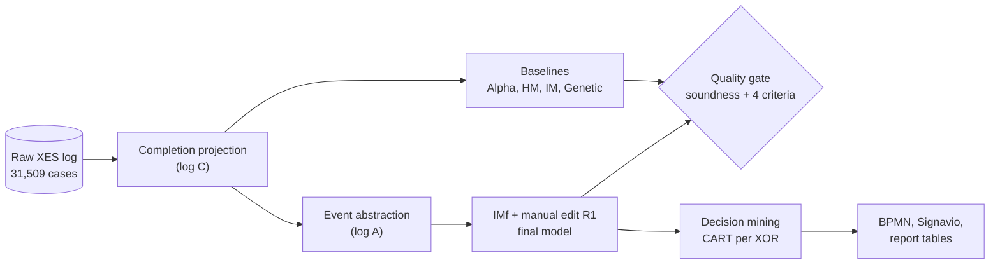

# BPIC-17 Process Mining

Python implementation of Assignment I on the BPI Challenge 2017 loan-application
log: event-log analysis, process discovery, conformance checking, model
refinement and decision mining. Analysis language **Python 3.12.10**,
process-mining library **PM4Py 2.7.23.11**; the LaTeX report lives in [`report/`](report/).

## Pipeline



Details of every stage, the code layers and the data artefacts:
[docs/ARCHITECTURE.md](docs/ARCHITECTURE.md).

## Results at a glance

| Assignment step | Result |
|---|---|
| 3.2 Log statistics | 31,509 cases, 1,202,267 events, 26 activities, 15,930 variants; independently verified against the raw XML |
| 3.3.1 Discovery | Alpha, Heuristics (with dependency sweep), Inductive and Genetic Miner on the same completion projection |
| 3.3.2 Quality | Soundness gate and all four quality criteria for every model; only IM-based models are sound ([comparison](results/comparison/model_comparison.md)) |
| 3.3.3 Refinement | Logging artefacts removed before refinement (edge cases kept), frequent-variant IMf, process-tree edit R1 ([event abstraction](docs/EVENT_ABSTRACTION.md)) |
| 3.3.4 Decision mining | Branch probabilities and tuned CART conditions at all 11 XOR splits, shown directly in the BPMN ([decision mining](docs/DECISION_MINING.md)) |
| 3.4 Advanced analysis | Not implemented |

Final model ([`results/final/`](results/final/), [BPMN figure](results/final/final_bpmn.pdf)):

| Criterion | Measure | Value |
|---|---|---:|
| Fitness | exact whole-case replay (requirement: at least 80 %) | 85.35 % |
| Precision | Align-ET | 0.826 |
| Generalization | alignment-based | 0.989 |
| Simplicity | nodes / Extended Cardoso / ECyM | 56 / 30 / 35 |
| Structure | sound workflow net; BPMN tasks / XOR / AND pairs | 17 / 11 / 2 |
| Decisions | mean held-out balanced accuracy; cases fully replayable with hard guards (test) | 0.790; 13.28 % |

The earlier final model without event abstraction (80.43 %, 0.695, 98 nodes) is
archived in [`results/before_abstraction/`](results/before_abstraction/); a
comparison of all models on one common log is in
[`results/abstraction/comparison.csv`](results/abstraction/comparison.csv). The
learned guards are statistical associations, not validated bank policy.

## Quick start (Windows)

Prerequisites: Git, Python 3.12 on PATH; for the report a TeX distribution with Latexmk.

```powershell
git clone https://github.com/Marcikschmid/bpic17-process-mining.git
Set-Location bpic17-process-mining
.\scripts\setup.ps1                                        # .venv, pinned packages, Graphviz
.\.venv\Scripts\python.exe scripts/download_data.py        # raw log + checksum verification
.\.venv\Scripts\python.exe scripts/evaluate_models.py --prepare
.\.venv\Scripts\python.exe -m unittest discover -s tests   # 53 tests
.\report\build.ps1                                         # report/build/main.pdf
```

The full command sequence for every stage is in [docs/REPRODUCE.md](docs/REPRODUCE.md).
The report build uses only files under `report/`; it needs neither Python nor the data.

## Repository layout

| Path | Content |
|---|---|
| [`src/`](src/) | Reusable library: import, projection, event abstraction, quality gate, finite-state replay/alignments, decision mining |
| [`scripts/`](scripts/README.md) | Entry points, one task each, grouped by stage |
| [`tests/`](tests/) | Unit tests on small examples and reference results |
| [`results/`](results/README.md) | Generated models, records, tables and figures, one folder per stage |
| [`report/`](report/README.md) | LaTeX report with selected, hash-checked copies of tables and figures |
| [`docs/`](docs/README.md) | Architecture, reproduction, method notes, design decisions, AI-use record |
| [`data/`](data/README.md) | Data provenance and checksums; the raw log itself is downloaded, not tracked |
| [`notebooks/`](notebooks/) | Getting-started notebook for exploring the log |
| [`literature/`](literature/README.md) | Source catalogue of published BPIC-17 analyses |

Not tracked: `.venv/`, `.tools/`, `tmp/` (sequence caches, alignment checkpoints),
`data/raw/`, `report/build/`.

## How PM4Py is used

| Component | Implementation |
|---|---|
| XES import, discovery | PM4Py `read_xes`; Alpha, Heuristics, Inductive (IM/IMf) and Genetic Miner |
| Process trees, Petri nets, BPMN | PM4Py objects, conversion, PNML/PTML/BPMN import and export |
| Quality metrics | PM4Py token replay, ETC/Align-ET precision, generalization, arc-degree simplicity |
| Own implementations | Exact whole-case replay, finite-state alignments and Align-ET, simplicity measures; all cross-checked against PM4Py |
| Decision rules | Alignment-based data snapshots (de Leoni & van der Aalst 2013) and scikit-learn CART |

## Documentation

- [Architecture](docs/ARCHITECTURE.md) and [reproduction](docs/REPRODUCE.md)
- [Event, case, trace, variant](docs/CONCEPTS.md) with BPIC-17 values
- [37 design decisions](docs/DESIGN_DECISIONS.md): alternatives, evidence, limitations
- [All method notes](docs/README.md), one per assignment step

## Data, report and licences

Data: Boudewijn van Dongen, *BPI Challenge 2017*,
[doi:10.4121/uuid:5f3067df-f10b-45da-b98b-86ae4c7a310b](https://doi.org/10.4121/uuid:5f3067df-f10b-45da-b98b-86ae4c7a310b),
4TU General Terms of Use ([data/README.md](data/README.md)). The raw file is never
modified; every derived view is computed in code.

The report is in English (at most five main pages plus appendix). Its scientific
text is the author's own; generated content is limited to tables, figures and
keyword notes, and AI assistance is recorded in [docs/AI_USAGE.md](docs/AI_USAGE.md).

The repository contains no licence file for its own code. The TUM LaTeX template
keeps its own licence notices; dataset terms and third-party software licences apply separately.
