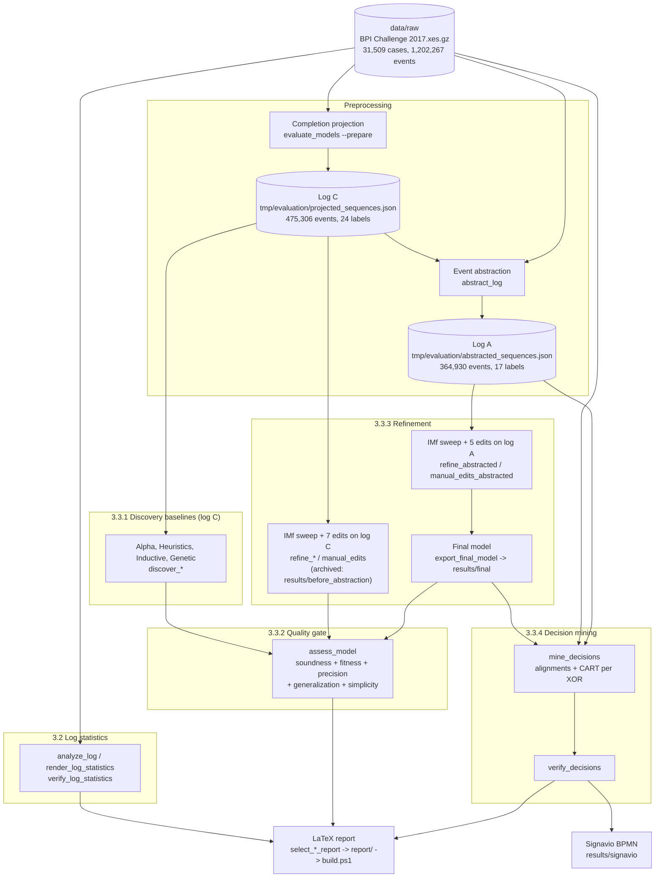
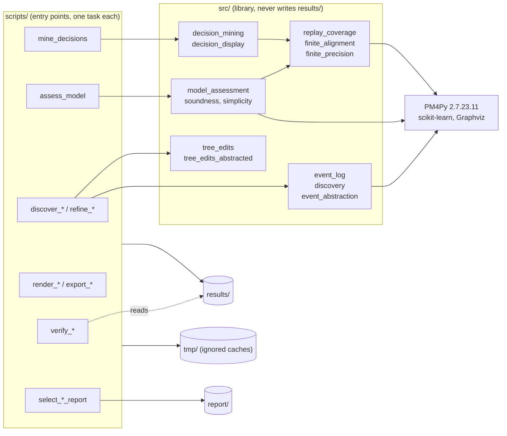

# Architecture

How the code, the data artefacts and the report fit together. For commands see
[REPRODUCE.md](REPRODUCE.md); for the reasoning behind each choice see
[DESIGN_DECISIONS.md](DESIGN_DECISIONS.md).

## 1. Pipeline at a glance

One raw event log feeds every stage. Each stage is a small set of Python entry
points in `scripts/` that call the library in `src/` and write their outputs to
one folder under `results/`. The LaTeX report never reads analysis outputs
directly; explicit selection scripts copy audited tables and figures into `report/`.

| Stage | Entry points (`scripts/`) | Library (`src/`) | Main outputs | Method notes |
|---|---|---|---|---|
| Data | `download_data.py`, `inspect_log.py` | `event_log.py` | `data/raw/` (ignored), `data/manifest.json` | [data/README.md](../data/README.md) |
| 3.2 Statistics | `analyze_log.py`, `render_log_statistics.py`, `verify_log_statistics.py` | `log_statistics.py` | `results/tables/` | [STATISTICS.md](STATISTICS.md) |
| Preprocessing (log C) | `evaluate_models.py --prepare` | `discovery.py` (`completion_projection`) | `tmp/evaluation/projected_sequences.json` | [DISCOVERY.md](DISCOVERY.md) |
| 3.3.1 Discovery | `discover_models.py`, `discover_alpha.py`, `discover_heuristics_variants.py`, `discover_genetic.py` | `discovery.py`, `genetic_miner.py` | `results/models/`, `results/alpha/`, `results/heuristics/`, `results/genetic/` | [DISCOVERY.md](DISCOVERY.md), [MINER_PARAMETERS.md](MINER_PARAMETERS.md) |
| 3.3.2 Quality gate | `assess_model.py`, `render_model_comparison.py`, `render_metric_methods.py` | `model_assessment.py`, `soundness.py`, `replay_coverage.py`, `finite_alignment.py`, `finite_precision.py`, `simplicity.py` | `results/assessment/`, `results/comparison/` | [EVALUATION.md](EVALUATION.md) |
| 3.3.3 Refinement before abstraction | `refine_model.py`, `refine_frequent.py`, `export_refined_model.py`, `manual_edits.py` | `tree_edits.py` | `results/refinement/`, `results/manual_edits/`, `results/before_abstraction/` | [REFINEMENT.md](REFINEMENT.md), [MANUAL_EDITS.md](MANUAL_EDITS.md) |
| Preprocessing (log A) | `abstract_log.py` | `event_abstraction.py` | `tmp/evaluation/abstracted_sequences.json`, `results/abstraction/abstraction_audit.json` | [EVENT_ABSTRACTION.md](EVENT_ABSTRACTION.md) |
| 3.3.3 Final refinement | `refine_abstracted.py`, `manual_edits_abstracted.py`, `export_final_model.py`, `holdout_check.py`, `compare_abstraction.py` | `tree_edits_abstracted.py` | `results/abstraction/`, `results/final/` | [EVENT_ABSTRACTION.md](EVENT_ABSTRACTION.md) |
| 3.3.4 Decision mining | `mine_decisions.py`, `render_*decision*.py`, `render_branch_probabilities.py`, `verify_decisions.py`, `export_signavio.py` | `decision_mining.py`, `decision_display.py`, `finite_alignment.py` | `results/decision_mining/`, `results/signavio/` | [DECISION_MINING.md](DECISION_MINING.md), [SIGNAVIO.md](SIGNAVIO.md) |
| Report | `select_*_report.py`, `select_miner_overview.py`, `report/build.ps1` | none | `report/tables/`, `report/figures/`, `docs/manifests/` | [report/README.md](../report/README.md) |

The complete script list, grouped by stage, is in [scripts/README.md](../scripts/README.md);
the content of every results folder is in [results/README.md](../results/README.md).

## 2. Code layers

- `src/` holds reusable logic and never writes to `results/`. The only paths it
  knows are defaults: the raw log (`event_log.py`), the two sequence caches
  (`model_assessment.py`) and alignment checkpoints in `tmp/` (`alignment.py`).
  Scripts decide output paths, parameters and file formats.
- Scripts may import small helpers from other scripts (for example `sha` and
  `write_json` from `scripts/assess_model.py`); the package root is the repository root.
- `src/runtime.py` configures the project-local Graphviz and the matplotlib cache for
  the current process only; scripts call it before importing PM4Py.
- Only the `select_*` scripts write into `report/`, and each copy is recorded with
  its SHA-256 in `docs/manifests/`.

## 3. Data artefacts

| Artefact | Built by | Used by | Notes |
|---|---|---|---|
| `data/raw/BPI Challenge 2017.xes.gz` | `download_data.py` | everything | never modified; SHA-256 in `data/manifest.json` |
| Log C: `tmp/evaluation/projected_sequences.json` | `evaluate_models.py --prepare` | baselines, old refinement, quality gate | completion events, original XES order, all cases, raw SHA-256 stored |
| Log A: `tmp/evaluation/abstracted_sequences.json` | `abstract_log.py` | final refinement, final assessment, decision mining | log C minus logging artefacts; built from the raw log and checked against log C |
| `tmp/decision_mining/<sha>.json` | `mine_decisions.py` | `verify_decisions.py` | optimal alignment per variant, keyed by model + cache identity |
| `tmp/evaluation/*` checkpoints | `src/alignment.py` | long PM4Py alignment runs | resumable after interruption |
| `results/<stage>/` | stage scripts | renderers, report selection | models (PNML/PTML/BPMN), JSON records, CSV/TeX tables, figures |
| `docs/manifests/*.json` | `select_*`, `setup_*`, `verify_genetic_trial.py` | verification | provenance of report copies and installed tools |

Every assessment record names the sequence cache it was computed on
(`evaluation_input.cache`). Values computed on log C and on log A are not
directly comparable; `compare_abstraction.py` evaluates all models on log A.

## 4. Library modules (`src/`)

| Module | Responsibility |
|---|---|
| `event_log.py` | Load the unchanged XES log with PM4Py (no filtering) |
| `discovery.py` | Completion projection with order/case checks; IM and HM parameters |
| `event_abstraction.py` | Rules that drop mirror and work-item events and collapse simultaneous repetitions |
| `log_statistics.py` | Raw-log statistics for 3.2 (all lifecycle states) |
| `genetic_miner.py` | Seeded wrapper around the native PM4Py Genetic Miner |
| `model_assessment.py` | One quality gate for any Petri net: soundness, four quality dimensions, diagnostics |
| `soundness.py` | WF-net structure, classical/easy/relaxed soundness, Woflan cross-check |
| `replay_coverage.py` | Exact whole-case acceptance on the complete marking graph; language equivalence |
| `finite_alignment.py` | Optimal alignments on a finite marking graph (cross-checked against PM4Py costs) |
| `finite_precision.py` | PM4Py Align-ET computed on the finite marking graph |
| `simplicity.py` | Own size, Extended Cardoso and Extended Cyclomatic measures |
| `net_certificates.py`, `validation.py` | Exact dead-transition and replay-ceiling certificates for unbounded nets |
| `alignment.py`, `quality.py` | Resumable PM4Py alignments; memory-bounded PM4Py Align-ET |
| `tree_edits.py`, `tree_edits_abstracted.py` | Named process-tree edits for the two refinement bases |
| `decision_mining.py` | BPMN flow semantics, pre-decision data snapshots, CART rules, guarded replay |
| `decision_display.py` | Readable rule blocks at each XOR gateway |
| `runtime.py` | Process-local Graphviz and cache configuration |

## 5. Design invariants

1. **Raw data stays unchanged.** Projections are derived in code and cached in
   `tmp/` together with the raw SHA-256; a changed raw file fails the run.
2. **All cases are evaluated.** Discovery may train on a documented subset
   (frequent variants, training split); every metric uses all 31,509 cases.
3. **One quality gate for every model.** `assess_model.py` applies the same
   soundness and metric code to baselines, candidates and the final model.
4. **Own implementations are cross-checked.** Finite-state replay, alignments and
   Align-ET are compared with unmodified PM4Py on fixed-seed samples.
5. **Selection rules are written down before evaluation.** They live in the
   docstrings of the selecting scripts and are copied into the result JSON;
   deviations are stated there and in [DESIGN_DECISIONS.md](DESIGN_DECISIONS.md).
6. **Every result carries provenance.** JSON records store input-cache,
   model and implementation hashes; caches are reused only when the identity matches.
7. **Analysis never writes the report.** Report copies are explicit, hashed and
   verifiable; the LaTeX build needs no Python and no data.
8. **Report prose is the author's own.** Generated material in `report/` is
   limited to tables, figures, captions and keyword notes ([AI_USAGE.md](AI_USAGE.md)).

## 6. Verification

| Check | What it covers |
|---|---|
| `python -m unittest discover -s tests` | 53 tests on small examples: projection, abstraction, metrics, replay, alignments, decision inputs |
| `verify_log_statistics.py` | 3.2 statistics recomputed by an independent XML reader |
| `verify_evaluation.py`, `verify_refinement.py` | Case weights, checksums, PM4Py reference samples |
| `verify_genetic_trial.py`, `audit_*dead_transitions.py` | Genetic export and exact unboundedness/dead-transition certificates |
| `verify_decisions.py` | Every rule prediction, the case split, all raw-data snapshots, report copies |
| `export_signavio.py` | Signavio files: diagram completeness and language equivalence with the final net |

## 7. Extending the pipeline

- **New miner:** add a `discover_<name>.py` that reads log C, exports PNML to
  `results/<name>/`, then run `assess_model.py <pnml> --name <name>` and add the
  record to `render_model_comparison.py`.
- **New refinement step:** keep it a process-tree edit (sound by construction),
  add it to the edit module, state the selection rule before screening and keep
  evaluating on all cases.
- **Different preprocessing:** write a new sequence cache with the same schema
  (`case_id`, `activities`), pass it with `--cache`, and record it in the final
  model manifest so that decision mining applies the same view to the raw events.
